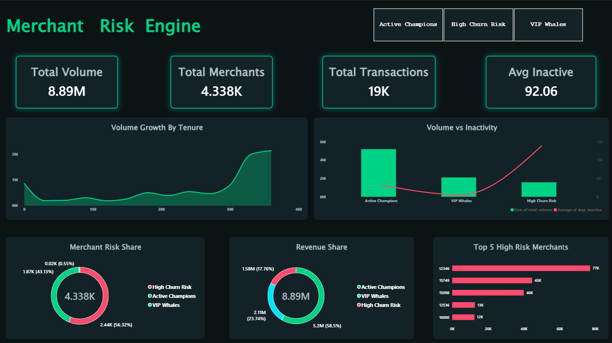

# Merchant-churn-analytics-LTV-engine

This is an end-to-end data system made to study, clean, and predict merchant payment habits across a massive raw dataset of **541,909 transactional logs**. The main dashboard screen gives management a clear, single-page view to find exactly which shopkeepers and businesses are stopping their payments, helping FinTech companies stop losing valuable revenue to competitors.

---

## Live Dashboard Operational Preview

### Executive Dark Theme Dashboard Preview

*Figure 1.0 shows the clean, single-page dark dashboard display tracking merchant processing volumes, loyalty tenure, inactivity gaps, and AI-flagged churn risks.*

---

## Core Business Value and ROI Impact: How It Saves Money

* **Merchant Loss Prevention:** Located a massive **43.13 percent churn risk rate**, catching **1,870 merchants** who stopped processing payments through the gateway. Flagging these silent dropouts early protects **1.58 Million (17.76 percent of total platform volume)** from walking away to rival apps.
* **Smart Retention Budget Targeting:** Instead of wasting discount money on all 4,338 accounts, the engine isolates the **Top 5 High-Risk Merchants** (led by Merchant `12346` with `77K` volume and `15749` with `45K` volume). Calling these top accounts first with zero-fee offers saves maximum revenue at the lowest support cost.
* **VIP Whale Protection:** Identified a small, elite group of **24 VIP Whales (0.55 percent of users)** who alone drive **2.11 Million (23.74 percent)** of all platform money, giving managers clear proof to assign them dedicated account support.

---

## Project Genesis: Data Engineering Execution

### Python Data Pipeline: What I Did, How, and Why?
I built a clean audit and loading script in Python (`Pandas`) that scans the raw **541,909 row** file before anything touches the database. Raw payment logs are full of broken data that crash dashboards and ruin machine learning math. My tool automatically removes **135,080 missing merchant IDs**, strips out **2,517 zero-price errors**, isolates **10,624 refunds**, and removes exact duplicate rows—leaving **392,692 spotless payment records** ready for MySQL.

### SQL Database Setup: What I Did, How, and Why?
I loaded the clean records into a structured **MySQL** database and wrote custom aggregation queries (`SUM`, `COUNT`, `DATEDIFF`, and `GROUP BY`). Raw transaction rows tell managers nothing about long-term habits. By grouping the data directly inside SQL, I compressed nearly 400,000 individual logs into **4,338 unique merchant report cards** tracking Total Volume, Transaction Count, Inactive Days, and Platform Tenure.

### Machine Learning Segmentation: What I Did, How, and Why?
I connected Python to MySQL, scaled the numbers fairly using `StandardScaler` so huge money figures wouldn't break the distance math, and trained an **Unsupervised K-Means Clustering** model (`Scikit-Learn`). Because raw payment logs don't come with "Churned" labels, K-Means automatically studied all four behavioral metrics together and sorted every merchant into three clear groups: **Active Champions**, **High Churn Risk**, and **VIP Whales**.

### Dashboard Visual Design: What I Did, How, and Why?
I linked the AI predictions to **Power BI** and designed a custom dark-mode control screen with glowing metric cards and rounded borders. Traditional bright white spreadsheets tire the eyes and hide answers across multiple confusing tabs. This dark canvas focuses management's attention immediately on red high-risk alerts and green revenue growth.

---

## System Architecture Layers: What the Canvas Holds

### Layer 1: The Top Header & Glowing KPI Cards
This covers the top 20 percent of the screen. The emerald **Merchant Risk Engine** title and clickable filter buttons anchor the top bar. 
* **Card 1 (Total Volume at 8.89M):** Tracks the total payment money flowing through the platform.
* **Card 2 (Total Merchants at 4.338K):** Shows the true count of unique active businesses on the network.
* **Card 3 (Total Transactions at 19K):** Measures total unique checkout batches processed.
* **Card 4 (Avg Inactive at 92.06 Days):** Acts as a health pulse showing the average silence gap across the merchant base.

### Layer 2: The Middle Visual Charts
This covers the middle 45 percent of the screen.
* **Left Chart (Volume Growth By Tenure):** A glowing emerald green area chart mapping merchant age against total money processed, proving how long-term loyalty drives massive revenue spikes after 300+ days.
* **Right Chart (Volume vs Inactivity):** A dual bar-and-line chart comparing total money bars against the rising coral-red inactivity line, visually proving how volume crashes as days inactive climb in the High Churn Risk group.

### Layer 3: The Bottom Risk Breakdown & Action Row
This covers the bottom 35 percent of the screen.
* **Bottom Left Donut (Merchant Risk Share):** Splits the 4,338 merchants by headcount, highlighting the 43.13 percent High Churn Risk slice in coral red.
* **Bottom Middle Donut (Revenue Share):** Splits the 8.89M total volume by money share, showing how Active Champions (58.5 percent) and VIP Whales (23.74 percent) anchor the business.
* **Bottom Right Bar Chart (Top 5 High Risk Merchants):** Ranks the exact top 5 highest-paying merchants inside the risky cluster (`12346`, `15749`, `15098`, `12536`, `16000`) so retention teams know exactly who to call first.

---

## Core Business Insights and Strategic Answers: What Are We Solving?

### Insight 1: Old Merchants Bring More Money.
* **The Problem:** Management needs to know if keeping merchants past their first few months actually increases processing volume.
* **The Fix:** The tenure area chart proves that new merchants start small, but once businesses stay past **300 days**, total processing volume jumps sharply past **2M**. Offering onboarding support during a merchant's first 90 days pays off heavily over a full year.

### Insight 2: Merchants Leaving the App.
* **The Problem:** Shopkeepers rarely close their accounts formally before switching to a rival payment app, causing silent revenue leaks.
* **The Fix:** The K-Means engine caught **1,870 merchants** sitting in the High Churn Risk cluster, representing **1.58M in at-risk revenue**. Running this pipeline weekly lets managers fire automated cashback offers the moment a merchant's inactivity crosses 45 to 60 days.

### Insight 3: Best Merchant Groups.
* **The Problem:** Treating a massive online seller the same as a tiny corner shop puts huge revenue at risk if the big seller faces a payment glitch.
* **The Fix:** The model isolated just **24 VIP Whales** who generate **2.11M** in volume—nearly a quarter of all platform money. Assigning dedicated relationship managers to these 24 accounts protects the core financial anchor of the company.

### Insight 4: Top 5 Merchants to Save First.
* **The Problem:** Customer support teams cannot manually call 1,870 at-risk merchants at once.
* **The Fix:** By filtering the High Churn Risk cluster by Total Volume, the dashboard hands managers a ready-to-call target list led by Merchant **`12346` (`77K`)** and **`15749` (`45K`)**, ensuring retention budgets go straight to the highest-return accounts first.
